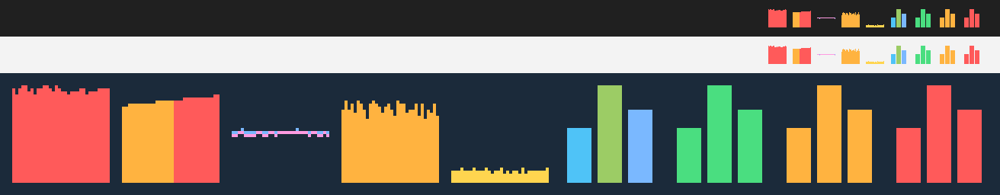

# blinkengraphs

Live CPU, memory, disk, network and latency graphs in the Windows 11 taskbar, inspired by iStat Menus, MenuMeters, gping and mtr. Click a graph to see a plain-language verdict on why the machine is slow or the network isn't responding.

## Install

Download the x64 or ARM64 MSI from the [latest release](https://github.com/reconbot/blinkengraphs-win/releases/latest) (or the [`main-latest`](https://github.com/reconbot/blinkengraphs-win/releases/tag/main-latest) prerelease, rebuilt on every push), run it, and choose **Just me** or **Everyone**. Settings survive uninstall. Builds are unsigned, so SmartScreen warns; `gh attestation verify <file> -R reconbot/blinkengraphs-win` checks provenance.

| Scope | Install | Uninstall |
|---|---|---|
| Per-user | `msiexec /i blinkengraphs-x64.msi /qn MSIINSTALLPERUSER=1 ALLUSERS=2` | `msiexec /x blinkengraphs-x64.msi /qn MSIINSTALLPERUSER=1 ALLUSERS=2` |
| Per-machine | `msiexec /i blinkengraphs-x64.msi /qn ALLUSERS=1` | `msiexec /x blinkengraphs-x64.msi /qn ALLUSERS=1` |

## What it shows

| Section | Meter (always visible) | Panel (on click) |
|---|---|---|
| CPU | total % | per-core, kernel share, top processes |
| Memory | commit charge, hard faults | physical, compressed, top processes |
| Network | down/up on the followed adapter | per adapter, errors |
| Disk | active time % | MB/s, response time, queue |
| Latency | RTT + loss to 1.1.1.1 | ICMP/TCP/DNS Probes to the gateway, Cloudflare and Quad9 over IPv4 and IPv6, and system DNS; per-hop trace |

Every metric, Probe, interval, color and aggregate is configurable. Nothing needs Administrator.

## Screenshots

Rendered by CI from fixture data on every push to `main`.

Taskbar Strip:

Tray Icons (actual size, then 4× zoom):

## Usage

- Click any Meter, or press `Ctrl+Alt+B`, to open the Panel. Click away or press `Esc` to close it.
- Right-click a Meter for Open, Settings and Quit.
- Settings live in `%APPDATA%\blinkengraphs\config.toml`; the Settings tab edits them live. History is stored in `history.db` in the same folder.
- Windows 11 hides new tray icons in the overflow menu: drag them onto the taskbar, or set **Taskbar display** to **Strip**.

## Milestones

- [x] **M0: skeleton.** Cargo workspace, Windows CI for x64 and ARM64, screenshots from fixtures, release-please, rolling `main-latest`, TCP hop-trace spike ([ADR 0006](docs/adr/0006-tcp-hop-traces-experimental.md))
- [x] **M1: Tray Icons, Probes, Panel.**
  - Collectors (PDH, IP Helper) and ICMP/TCP/DNS probes with an ICMP hop trace
  - Verdict
  - egui Panel with Settings
  - Hotkey
  - Pause while locked, display off or screen saver running
- [x] **M2: Taskbar Strip and History.**
  - Strip docked in the taskbar, falling back to Tray Icons
  - 7 days of one-minute Rollups in SQLite, browsable in the Panel's history ranges
- [x] **Themes.** Per-Probe colors, time windows and aggregates (p99, p95, p50, avg, max)
- [x] **M3: Distribution.** One MSI for per-user or per-machine installs, starting at sign-in ([ADR 0010](docs/adr/0010-single-dual-mode-msi.md))
- [ ] **Next:** text labels on Tray Icons and Strip cells where the graph alone doesn't say what it shows
- [ ] **Later: code signing** with Azure Artifact Signing ([ADR 0009](docs/adr/0009-azure-artifact-signing.md), deferred)
- [ ] **M4: Elevated Extras.** Optional LocalSystem companion service for per-process network bytes and UDP hop traces ([ADR 0008](docs/adr/0008-elevated-extras-via-companion-service.md))

## Repositories

| Repo | Contents |
|---|---|
| [blinkengraphs](https://github.com/reconbot/blinkengraphs) | Landing page and shared spec: vocabulary, Verdict rules, test vectors, tokens, icon |
| [blinkengraphs-win](https://github.com/reconbot/blinkengraphs-win) | Windows 11 app (Rust) |
| [blinkengraphs-mac](https://github.com/reconbot/blinkengraphs-mac) | macOS menu bar app (planned) |
| [blinkengraphs-ios](https://github.com/reconbot/blinkengraphs-ios) | iOS network diagnosis app (planned) |

## Docs

- [`docs/PLAN.md`](docs/PLAN.md): decisions, defaults, architecture
- [`docs/adr/`](docs/adr/): why things are the way they are
- [`docs/research/`](docs/research/): prior art and the Rust/Windows stack, with sources

## License

MIT OR Apache-2.0
